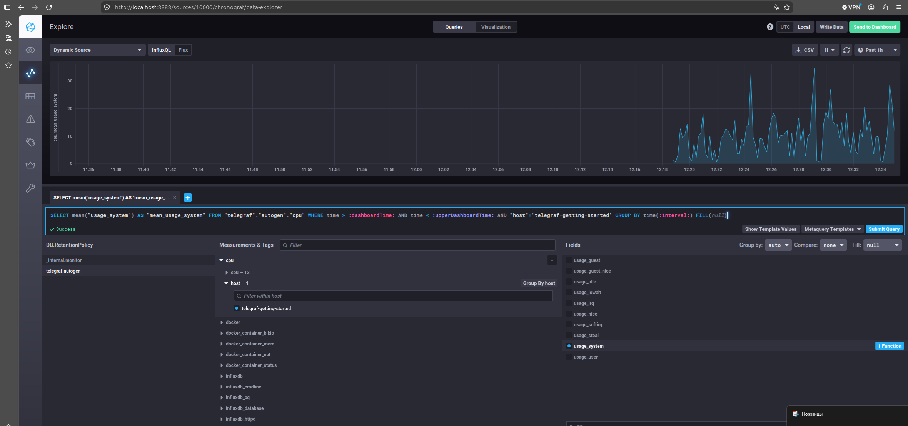
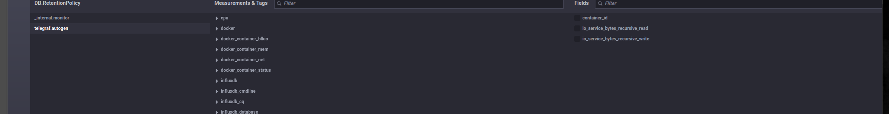

# Ответы на вопросы по мониторингу и TICK Stack

## 1. Минимальный набор метрик для мониторинга проекта

Проект представляет собой платформу вычислений, которая принимает
запросы по HTTP, выполняет вычисления с высокой нагрузкой на CPU и
сохраняет текстовые отчёты на диск. Для такого сервиса я бы вывел в
мониторинг следующие группы метрик.

### Ресурсы сервера

-   **CPU:** загрузка процессора в целом и по ядрам, время в
    user/system/iowait, load average. Это позволяет увидеть перегрузку
    вычислениями и понять, хватает ли процессорных ресурсов.
-   **RAM:** использование оперативной памяти, доступная память, swap и
    OOM-события. Нехватка памяти может приводить к замедлению работы и
    аварийному завершению процессов.
-   **Диск:** свободное место и процент заполнения файловой системы,
    использование inode, задержки и загрузка дисковой подсистемы. Отчёты
    сохраняются на диск, поэтому важно контролировать не только
    свободные гигабайты, но и возможность создавать новые файлы.
-   **Сеть:** входящий и исходящий трафик, ошибки и отброшенные пакеты.
    Это помогает выявлять сетевые ограничения и проблемы взаимодействия
    по HTTP.

### Метрики приложения и HTTP

-   количество входящих HTTP-запросов и запросов в секунду;
-   распределение кодов ответов: 2xx, 3xx, 4xx и 5xx;
-   задержка обработки запросов (минимум p50, p95 и p99);
-   количество ошибок и доля успешных запросов;
-   число одновременно выполняемых задач, очередь задач и длительность
    вычислений;
-   количество созданных отчётов, ошибки записи и время сохранения
    отчёта.

**Почему именно эти метрики:** они покрывают доступность сервиса,
качество HTTP-обслуживания, скорость вычислений и два критичных для
проекта ресурса --- CPU и диск. RAM, сеть и inode дополняют картину и
помогают найти причины деградации, а не только зафиксировать её
последствия.

## 2. Как объяснить менеджеру RAM, inodes и CPU и показать качество обслуживания

Менеджеру лучше показывать не технические названия метрик сами по себе,
а их влияние на работу клиентов.

-   **CPU (процессор)** --- вычислительная мощность сервера. Если
    процессор постоянно перегружен, задачи выполняются дольше, а
    клиентам приходится ждать.
-   **RAM (оперативная память)** --- рабочее пространство, в котором
    приложение держит данные во время вычислений. Если памяти не
    хватает, система начинает активнее использовать диск или может
    завершать процессы из-за нехватки памяти.
-   **Inodes** --- условные «слоты» файловой системы для хранения
    сведений о файлах и каталогах. Даже если на диске ещё есть свободные
    гигабайты, создание новых отчётов может стать невозможным, если
    закончились inode.

### Показатели качества обслуживания

Предложил бы простой дашборд с понятными для бизнеса показателями:

1.  **Доступность сервиса, %** --- доля времени, когда сервис отвечает и
    выполняет проверки доступности.
2.  **Успешные HTTP-запросы, %** --- доля запросов с успешными кодами
    ответа (обычно 2xx; правила исключений нужно согласовать).
3.  **Время ответа, p95** --- время, быстрее которого обрабатываются 95%
    запросов. Оно показывает опыт большинства клиентов и не скрывает
    медленные запросы средним значением.
4.  **Успешно завершённые вычисления, %** --- доля задач, завершившихся
    без ошибки.
5.  **Время подготовки отчёта** --- от получения задания до сохранения
    готового отчёта.
6.  **Ошибки сохранения отчётов** --- количество и доля неудачных
    операций записи.

Рядом с этими показателями можно разместить технические метрики CPU,
RAM, свободного места и inode. Так менеджер увидит и качество услуги, и
возможные причины ухудшения.

## 3. Как предоставить разработчикам ошибки приложения без отдельного бюджета на систему логирования

В первую очередь можно использовать уже имеющуюся инфраструктуру и
инструменты с открытым исходным кодом.

Возможный минимальный вариант:

-   приложение пишет логи в `stdout` и `stderr` в структурированном
    формате, например JSON;
-   Docker собирает стандартный вывод контейнеров;
-   на первом этапе разработчики получают доступ к логам через
    `docker logs` или централизованный просмотр логов средствами уже
    используемой платформы;
-   если нужен единый интерфейс и поиск, можно развернуть бесплатный
    стек **Grafana Loki + Promtail/Alloy + Grafana** либо
    **ELK/OpenSearch** --- выбор зависит от ресурсов и сложности
    эксплуатации.

В логах стоит фиксировать время, уровень (`INFO`, `WARN`, `ERROR`), имя
сервиса, окружение, текст ошибки, stack trace и идентификатор запроса
(`request_id` или `trace_id`). Пароли, токены, персональные и другие
секретные данные логировать нельзя.

Важно договориться о сроке хранения, ротации и ограничении объёма логов,
чтобы они сами не заполнили диск. Доступ разработчиков следует
ограничить необходимыми сервисами и окружениями.

**Практичный первый шаг без дополнительных затрат:** стандартизировать
вывод логов в контейнерах и предоставить разработчикам контролируемый
доступ к `docker logs`. При росте потребностей добавить Loki или другое
централизованное хранилище.

## 4. Почему отношение 2xx/all не достигает 99%, хотя ответов 4xx и 5xx нет

Формула из задания:

`sum(2xx_requests) / sum(all_requests)`

показывает долю ответов 2xx среди всех учтённых запросов. Если результат
около 70%, а 4xx и 5xx не наблюдаются, это не обязательно означает
ошибку мониторинга: в знаменатель могут попадать ответы **3xx**
(например, перенаправления), а также запросы с кодом, который не был
классифицирован или не попал в ожидаемые серии метрик.

Нужно проверить: - какие именно коды ответа входят в `all_requests`; -
учитываются ли 3xx и неучтённые/пустые значения статуса; - одинаковы ли
фильтры, временные интервалы и группировки у числителя и знаменателя; -
не суммируются ли разные наборы метрик или дублирующиеся серии; -
совпадают ли единицы измерения и правила агрегации.

Для проверки полезно вывести отдельные счётчики по каждому классу кодов:
2xx, 3xx, 4xx, 5xx и прочие/неизвестные. Тогда станет видно, куда уходят
оставшиеся 30%.

Если под успешным обслуживанием понимаются только ответы 2xx, формула
корректна при условии, что `all_requests` действительно содержит все
запросы. Если бизнес-правила считают некоторые 3xx успешными, это нужно
явно отразить в числителе. Само по себе отсутствие 4xx и 5xx ещё не
доказывает, что все запросы завершились кодом 2xx.

## 5. Плюсы и минусы pull- и push-моделей мониторинга

### Pull-модель

Система мониторинга сама обращается к источникам метрик через заданные
интервалы и забирает данные.

**Плюсы:** - центральная система контролирует расписание и частоту
опроса; - проще обнаружить недоступный источник: опрос не удался; - не
требуется, чтобы каждый источник самостоятельно отправлял данные на
сервер мониторинга; - удобно управлять списком целей и конфигурацией
сбора.

**Минусы:** - мониторинг должен иметь сетевой доступ к источникам; -
сложнее работать с узлами за NAT, в закрытых сетях и с краткоживущими
задачами; - при большом количестве целей растёт нагрузка на систему
опроса; - слишком редкий интервал может пропускать короткие события.

### Push-модель

Источники сами отправляют метрики в систему мониторинга или
промежуточный приёмник.

**Плюсы:** - подходит для динамических и краткоживущих задач; - удобно
для узлов, которые недоступны для входящих подключений; - источник может
отправлять данные через исходящее соединение; - можно отправлять метрики
сразу после события, если это поддерживается системой.

**Минусы:** - нужно обеспечить доступность приёмника и защитить его от
перегрузки; - сложнее понять, источник перестал работать или просто
перестал отправлять данные; - требуется управлять очередями, повторными
отправками и потерей данных; - при большом числе источников нужно
контролировать поток поступающих метрик.

На практике часто применяют гибрид: регулярный pull для постоянных
сервисов и push для краткоживущих задач, событий или агентов в сетях,
куда нельзя подключиться извне.

## 6. Какие системы используют push, pull или гибридную модель

  **Prometheus**          Pull                    Обычно Prometheus сам
                                                  опрашивает HTTP
                                                  endpoint `/metrics`.
                                                  Для краткоживущих задач
                                                  может использоваться
                                                  Pushgateway, поэтому
                                                  возможен дополнительный
                                                  push-сценарий.

  **TICK Stack**          Преимущественно push    Telegraf обычно
                          между компонентами      собирает метрики и
                          сбора и хранения;       отправляет их в
                          возможны оба подхода    InfluxDB. При этом
                                                  отдельные входные
                                                  плагины Telegraf могут
                                                  опрашивать внешние
                                                  источники, то есть
                                                  внутри сбора
                                                  применяется pull.

  **Zabbix**              Гибридная               Zabbix server/proxy
                                                  может опрашивать агент
                                                  (passive checks), а
                                                  агент может сам
                                                  отправлять значения
                                                  серверу (active
                                                  checks). Также
                                                  поддерживаются
                                                  trapper-элементы для
                                                  принимаемых данных.

  **VictoriaMetrics**     Гибридная               Может принимать данные
                                                  через push-протоколы,
                                                  например Prometheus
                                                  remote write и Influx
                                                  line protocol; также
                                                  поддерживает pull-сбор
                                                  через vmagent и
                                                  совместимые механизмы
                                                  опроса.

  **Nagios**              Гибридная, с            Обычно Nagios запускает
                          преобладанием           плагины и проверяет
                          pull-проверок           состояние узлов и
                                                  сервисов. Для пассивных
                                                  проверок результаты
                                                  могут поступать извне
                                                  через механизм внешних
                                                  команд.


## 7. Развёртывание TICK Stack с Docker Compose

Для выполнения практической части необходимо:

1.  Склонировать предоставленный учебный репозиторий.
2.  Перейти в каталог проекта.
3.  Проверить файлы `docker-compose.yml` и переменные окружения.
4.  Запустить стек командой `docker compose up -d`.
5.  Проверить состояние контейнеров командой `docker compose ps`.
6.  Открыть веб-интерфейс Chronograf по адресу <http://localhost:8888>.

### Назначение компонентов

-   **Telegraf** --- собирает системные и прикладные метрики.
-   **InfluxDB** --- хранит временные ряды.
-   **Chronograf** --- предоставляет веб-интерфейс для просмотра данных
    и построения графиков.
-   **Kapacitor** --- обрабатывает потоки и пакетные данные, позволяет
    настраивать правила и реакции на события.

### Проверка результата

В Chronograf нужно убедиться, что подключена база данных Telegraf и
доступны метрики. Например, в Data Explorer можно выбрать:

-   база: `telegraf.autogen`;
-   measurement: `cpu`;
-   tag `host`: `telegraf-getting-started`;
-   field: `usage_system`.


## 8. Построение графика утилизации CPU в Chronograf

Для построения графика необходимо открыть веб-интерфейс Chronograf по адресу [http://localhost:8888](http://localhost:8888) и перейти во вкладку **Data Explorer**.

Порядок действий:

1. Нажать **Add a query**.
2. Изучить список доступных баз данных и выбрать `telegraf.autogen`.
3. В разделе **Measurements** выбрать `cpu`.
4. В тегах выбрать `host`, затем значение `telegraf-getting-started`.
5. В разделе **Fields** выбрать `usage_system`.
6. Выполнить запрос. В нижней части интерфейса появится график утилизации CPU.

### Скриншот


## 9. Подключение Docker input plugin в Telegraf

Для сбора метрик Docker в конфигурацию Telegraf добавляется входной плагин `inputs.docker`:

```toml
[[inputs.docker]]
  endpoint = "unix:///var/run/docker.sock"
```

Параметр `endpoint` указывает Telegraf на Unix-сокет Docker Engine. Через него плагин получает сведения о контейнерах и собирает доступные Docker-метрики.

Чтобы контейнер Telegraf мог обратиться к Docker API, сокет хоста необходимо подключить внутрь контейнера. В `docker-compose.yml` для сервиса Telegraf в задании приведён такой пример:

```yaml
telegraf:
  image: telegraf:1.4.0
  privileged: true
  volumes:
    - ./telegraf/telegraf.conf:/etc/telegraf/telegraf.conf:Z
    - /var/run/docker.sock:/var/run/docker.sock:Z
  links:
    - influxdb
  ports:
    - "8092:8092/udp"
    - "8094:8094"
    - "8125:8125/udp"
```
### Скриншот

